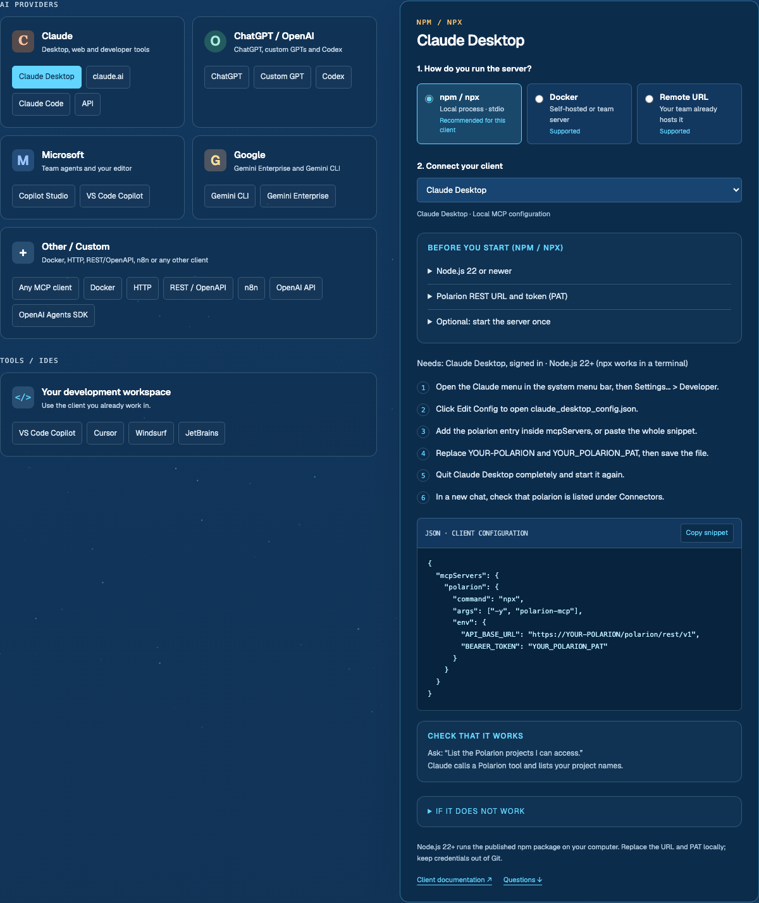

<div align="center">

# Polarion MCP

**Your Polarion work, one conversation away.**

Find requirements, review documents and prepare test runs through your AI assistant.
An open-source [Model Context Protocol](https://modelcontextprotocol.io) server that exposes **every Polarion REST operation** (284 tools, generated from the current API definition).

[](https://github.com/phillipboesger/polarion-mcp/actions/workflows/ci.yml)
[](https://www.npmjs.com/package/polarion-mcp)
[](https://github.com/phillipboesger/polarion-mcp/pkgs/container/polarion-mcp)
[](LICENSE)

[**Connect your assistant**](https://polarion-mcp.boesger.com/#clients) · [Daily workflows](https://polarion-mcp.boesger.com/#daily-use) · [Tool catalog](src/tools.ts)


</div>

On this page:

- [What the connector does for you](#what-the-connector-does-for-you)
- [A day with Polarion MCP](#a-day-with-polarion-mcp)
- [Get connected](#get-connected)
- [FAQ](#faq)
- [Feedback and community](#feedback-and-community)
- [Documentation](#documentation)
- [License](#license)

## What the connector does for you


**Your AI client → Polarion MCP → your Polarion REST API.** Ask a question; the assistant chooses tools, reads the returned data and proposes an answer or change.

- **Find answers:** search requirements and defects, read LiveDocs and inspect traceability links.
- **Prepare work:** draft test cases, prepare runs and record the test outcomes your team supplies.
- **Change data, safely:** the assistant can create and update Polarion data, and every write can be previewed first (`dry_run: true` shows the exact request without sending it). Prefer read access only? `MCP_READ_ONLY=1` blocks all writes. Set approval rules in your AI client; previews do not create an approval lock.
- **Inspect what you run:** MIT source, release SBOMs, build provenance and signed container images. See [supply-chain verification](docs/quality/supply-chain.md).


| Domain | Outcome |
|---|---|
| Work items | Find requirements, triage defects, prepare field updates. |
| Documents and pages | Read LiveDocs, inspect parts, manage attachments and supported pages. |
| Test management | Prepare runs and record supplied results. |
| Plans and collections | Review release scope and document collections. |
| Projects, people and configuration | Discover accessible projects, users, allowed field values and metadata. |

The [landing page](https://polarion-mcp.boesger.com/#features) shows counts by domain, computed from `src/tools.ts`. The **284 tools** count covers generated REST operations; configured toolsets and additional helpers change the exposed catalog. Selected Work Item writes validate enumeration values, custom-field keys and user references. [Features and limits](docs/features.md) describe the scope.

## A day with Polarion MCP


These are illustrative conversations using real tools, not recorded outputs. Project types, link roles and permissions vary.

| Ask your assistant | Tools and result | Your control |
|---|---|---|
| “Which open defects could block this release?” | `getWorkItems`, `getWorkItem`: a scoped list of severity, owners and missing information. | Read-only triage; approve any later reassignment. |
| “Review this LiveDoc and propose clearer acceptance criteria for REQ-17.” | `getDocument`, `getDocumentParts`, `getWorkItem`, `patchWorkItem`: a rewrite of the requirement’s description. | Preview with `dry_run: true`; approve before saving. |
| “Draft tests from these requirements, then record the results I provide.” | `getWorkItems`, `postWorkItems`, `postTestRuns`, `postTestRecords`: proposed cases and a run, then supplied outcomes. | Check existing tests, preview each write and approve. The connector does not execute product tests. |
| “Summarize this release plan and its latest test runs.” | `getPlan`, `getWorkItems`, `getTestRuns`: a draft status update with source IDs and missing data. | You decide release readiness. |
| “Find requirements without a verifies link to a test case.” | `getWorkItems`, `getLinkedWorkItems`: a scoped gap list and existing candidate tests. | Confirm link roles and scope before creating anything. |

[Explore the chat-style walkthroughs](https://polarion-mcp.boesger.com/#daily-use). For larger work, follow the [worked task](docs/example-task.md): read items one by one, check existing coverage, propose changes, then verify the result.

## Get connected



**First: how do you run the server?** You need a REST-enabled Polarion instance and a PAT.

| Server choice | Use it when | What runs |
|---|---|---|
| **npm / npx** | Your desktop or coding client supports local MCP. | The client launches a stdio process with Node.js 22+ and your PAT. |
| **Docker** | You are setting up your own or a team server. | Streamable HTTP, with each caller’s PAT. Add HTTPS and OAuth for cloud connectors. |
| **Remote URL** | Your team already hosts it. | Nothing to install locally; get the endpoint from your administrator. |

Choose your client in the [inline setup picker](https://polarion-mcp.boesger.com/#clients). It recommends a server choice, explains unsupported options, and shows the server command, client snippet and short steps together. Claude Desktop, Claude Code, Cursor and VS Code accept local or remote setups. **claude.ai and ChatGPT’s hosted connector path use a reachable HTTPS server**, rather than directly launching npx. OpenAI also offers [Secure MCP Tunnel](https://developers.openai.com/api/docs/guides/secure-mcp-tunnels) for private servers; that requires separate setup and permissions.

<!-- clients:start -->
| Group | Setup |
|---|---|
| [Claude](https://polarion-mcp.boesger.com/#setup/claude-desktop) | Claude Desktop and Claude Code: local or remote; claude.ai and API: HTTPS server. |
| [ChatGPT / Codex](https://polarion-mcp.boesger.com/#setup/chatgpt-apps) | ChatGPT connector: HTTPS; Custom GPT Actions: REST/OpenAPI; Codex: local or remote. |
| [Gemini, editors, other providers](https://polarion-mcp.boesger.com/#setup/cursor) | Gemini Enterprise and CLI, VS Code, Cursor and more; OpenAI API, Agents SDK or any MCP client. |
| [Custom / team server](https://polarion-mcp.boesger.com/#setup/generic-stdio) | Other AI provider / any MCP client: stdio or HTTP; Docker, REST/OpenAPI and n8n. |
<!-- clients:end -->

**Local example:** paste this into Claude Desktop’s Developer config or a compatible client’s private MCP settings. Replace the URL and PAT, merge with existing settings, then reconnect. Fully quit and restart Claude Desktop.

```json
{
  "mcpServers": {
    "polarion": {
      "command": "npx",
      "args": ["-y", "polarion-mcp"],
      "env": {
        "API_BASE_URL": "https://YOUR-POLARION/polarion/rest/v1",
        "BEARER_TOKEN": "YOUR_POLARION_PAT"
      }
    }
  }
}
```

**Docker example:** the published image starts an HTTP server on a loopback port.

```bash
docker run -d --name polarion-mcp \
  -p 127.0.0.1:3000:3000 \
  -e API_BASE_URL=https://YOUR-POLARION/polarion/rest/v1 \
  -e MCP_ALLOWED_HOSTS=localhost:3000,127.0.0.1:3000 \
  ghcr.io/phillipboesger/polarion-mcp:1.4.0
```

For a local HTTP client, use `http://localhost:3000/mcp` with `Authorization: Bearer YOUR_POLARION_PAT`. For a team, proxy HTTPS to that port and add the public hostname to `MCP_ALLOWED_HOSTS`. Cloud connectors also need `MCP_PUBLIC_URL`, a stable `MCP_TOKEN_SECRET`, exact redirect allowlists and a `TRUST_PROXY` setting matching the real proxy chain. The picker includes that server configuration for claude.ai and ChatGPT. See [deployment](docs/deployment.md#docker) for operations details.

**Other AI provider / any MCP client:** choose [Any MCP client](https://polarion-mcp.boesger.com/#setup/generic-stdio) for stdio or HTTP connection shapes. For OpenAPI clients, Custom GPT Actions and n8n, run the **separate REST wrapper** with a deployment PAT and `HTTP_API_KEY`; the [REST setup](https://polarion-mcp.boesger.com/#setup/rest-wrapper) includes its command and schema URLs.

Keep credentials out of Git. There is no public Polarion relay. Finish with a read-only check: “List the Polarion projects I can access.” [Vendor sources and compatibility notes](docs/clients.md) explain the documented paths.

## FAQ

<!-- faq:start -->
<details><summary>Which setup do I need?</summary>

For a desktop or coding client, start with npm / npx: your client launches the server and holds the Polarion URL and token in private settings. To share one server with a team, use Docker. For claude.ai or a ChatGPT connector you need the public HTTPS address of a server with OAuth login; if your team already runs one, pick Remote URL. Custom GPT Actions use the separate REST wrapper.

</details>
<details><summary>How do I create a Polarion personal access token (PAT)?</summary>

Log in to Polarion, open your user page and click Personal Access Token (direct link: `https://YOUR-POLARION/polarion/#/user_tokens?id=YOUR_USERNAME`). Enter a name and an expiry date, click Create Token and copy the token at once: Polarion shows it only once. If the page says `X-Rest-Token generation is not allowed on the server`, your Polarion administrator must set `com.siemens.polarion.rest.enabled=true` and `com.siemens.polarion.rest.security.restApiToken.enabled=true` in polarion.properties and restart Polarion. The message to forward is in Before you start.

</details>
<details><summary>What does Bearer mean in an Authorization header?</summary>

It is just the word Bearer, one space, then your token: `Bearer YOUR_POLARION_PAT`. Without the word Bearer the server answers 401.

</details>
<details><summary>Where do I keep my token safely?</summary>

In your personal client settings or an environment variable, never in a file inside a shared project or repository. Anyone who can read the file can act as you in Polarion. With the OAuth connectors you type the token only on the server's login page and the AI client never stores it.

</details>
<details><summary>Is my data safe? Which permissions apply?</summary>

Polarion enforces the token owner's permissions. Local stdio uses your configured token; remote MCP uses each caller's own token, directly or through the server's OAuth login, and the server stores no credentials. The REST wrapper is different: all callers share one deployment token. Tool results go to your AI client, so your provider's data handling and your organization's policies still apply.

</details>
<details><summary>Can I limit the server to read-only?</summary>

Yes. Set `MCP_READ_ONLY=1` in the server environment and restart or reconnect. It exposes only tools marked read-only and blocks writes. In write-enabled sessions, mutating tools offer a preview (`dry_run: true`) that shows the request without saving it.

</details>
<details><summary>Which Polarion versions work?</summary>

Live integration tests have passed on Polarion 2506 and 2606. The tools are generated from a Polarion OpenAPI definition, which does not guarantee every operation on every release. Verify the operations you rely on against your own instance.

</details>
<details><summary>Which AI clients can I use?</summary>

Any client that supports MCP over stdio or Streamable HTTP. The setup guide above lists the tested paths for Claude, ChatGPT and Codex, Copilot Studio, VS Code, Gemini, Cursor, Windsurf and JetBrains. Other clients can use the generic stdio or HTTP entries, or the REST wrapper.

</details>
<details><summary>It says 401 "Polarion did not accept this token".</summary>

Polarion does not know the token. It was copied with a line break or space, has expired or was revoked, or the REST address points to another Polarion. Run the curl test from Before you start, and create a new token if needed.

</details>
<details><summary>It says 403 "Polarion denied access".</summary>

Polarion knows the token but refuses it, so a new token will not help. Check in this order: the REST API is enabled (`com.siemens.polarion.rest.enabled=true`, then restart); your user has a license and read access to at least one project; no proxy, firewall or single sign-on in front of Polarion blocks `/polarion/rest` or the Authorization header. A bare 403 without Polarion's message in `docker logs` usually comes from such a proxy.

</details>
<details><summary>It says 503 "Polarion could not be reached".</summary>

The server got no usable answer from Polarion. Read the log line `Polarion token check failed` (`docker logs polarion-mcp`). Usual causes: the address does not end in `/polarion/rest/v1`, a firewall between server and Polarion, Polarion is down, `localhost` was used inside Docker, or a certificate error. Run the curl test on the machine that hosts the server, not on your laptop.

</details>
<details><summary>My AI client says "Disconnected" or "Failed to connect".</summary>

npm mode: run `npx -y polarion-mcp` in a terminal with the same values to see the real error. The usual causes are Node.js older than 22, a client that cannot find `npx` (see the Windows question), or a typo in the JSON file; restart the client completely after fixing it. Docker or remote: open `https://YOUR-SERVER/health` in a browser first, then run the initialize curl from Before you start, then read `docker logs polarion-mcp`.

</details>
<details><summary>The connector login in claude.ai or ChatGPT fails or loops.</summary>

Check in this order: `MCP_PUBLIC_URL` is exactly your public https address without a path; the browser shows a padlock; your proxy forwards everything (a plain Caddy `reverse_proxy` does); the callback of your client is allowed (`MCP_ALLOWED_REDIRECT_PRESETS=claude`, or the exact ChatGPT callback in `MCP_ALLOWED_REDIRECT_PREFIXES`; the server log says `redirect_uri rejected` otherwise); `MCP_TOKEN_SECRET` did not change between restarts. After changing `MCP_PUBLIC_URL` everyone has to sign in again.

</details>
<details><summary>Can claude.ai or ChatGPT connect to a server on my own laptop?</summary>

No. These connectors connect from the provider's cloud, so the address must be reachable on the public internet with HTTPS. On your own computer use the npm mode in Claude Desktop, Claude Code or Codex instead. Desktop and command-line tools such as VS Code, Cursor, Windsurf and Gemini CLI can use `http://localhost:3000/mcp`.

</details>
<details><summary>What is the difference between the ChatGPT connector and a Custom GPT?</summary>

The ChatGPT connector speaks MCP and everyone signs in with their own Polarion token. A Custom GPT uses the separate REST wrapper with one shared key (`HTTP_API_KEY`), so every call runs as the one Polarion user whose token the wrapper holds.

</details>
<details><summary>Certificate errors: the public HTTPS address does not work.</summary>

DNS must point to the server, ports 80 and 443 must be reachable from the internet and no other program may use them. Caddy's log (`journalctl -u caddy`, or the terminal) says why the certificate failed. Never switch certificate checking off for the public side.

</details>
<details><summary>My Polarion uses a company or self-signed certificate.</summary>

Give Node your company root certificate as a PEM file with `NODE_EXTRA_CA_CERTS=/path/ca.pem`. npm mode: add `"NODE_EXTRA_CA_CERTS": "/path/ca.pem"` to the `env` block of the client config. Docker: `-v /path/ca.pem:/certs/ca.pem:ro -e NODE_EXTRA_CA_CERTS=/certs/ca.pem`. As a last resort on a trusted internal network, `NODE_TLS_REJECT_UNAUTHORIZED=0` works but turns off all certificate checks.

</details>
<details><summary>Should I use polarion-mcp@latest or a pinned version?</summary>

The plain `npx -y polarion-mcp` can keep using an older copy from npm's cache. `polarion-mcp@latest` checks the registry at every start and picks up new releases, which can change the tool list without notice. `polarion-mcp@1.4.0` always runs exactly that release. Teams should pin and upgrade on purpose. To force a refresh, switch to `@latest` or a newer pinned version and restart the client.

</details>
<details><summary>How do I update the Docker server?</summary>

Choose the new tag on the GitHub package page, then run `docker pull ghcr.io/phillipboesger/polarion-mcp:NEWTAG`, `docker rm -f polarion-mcp`, and the same `docker run` command with the new tag. Keep `MCP_TOKEN_SECRET` unchanged so users stay signed in. With a team URL the administrator updates the server and you only reconnect.

</details>
<details><summary>It says "Unsupported engine" or the Node version is too old.</summary>

The package needs Node.js 22 or newer: `node -v` must print v22 or higher. Install the LTS from nodejs.org and open a new terminal; with nvm run `nvm install 22 && nvm use 22`. Desktop apps can use a different Node than your terminal, so install Node system-wide and fully restart the app. Docker avoids this because the image bundles Node 22.

</details>
<details><summary>Windows: the client cannot start npx.</summary>

Typical symptoms are `spawn npx ENOENT` or a server that never starts. Use `cmd` as the command with the arguments `/c`, `npx`, `-y`, `polarion-mcp`, because npx is `npx.cmd` on Windows. Backslashes in JSON paths must be doubled (`C:\\path\\ca.pem`). Restart the app completely after every change.

</details>
<details><summary>Port 3000 is already in use.</summary>

Change only the left number of the port mapping: `-p 127.0.0.1:3100:3000`, then use `http://localhost:3100/mcp` and set `MCP_ALLOWED_HOSTS=localhost:3100,127.0.0.1:3100`. Remove an old container with `docker rm -f polarion-mcp`. On macOS and Linux `lsof -i :3000` shows who uses the port; on Windows use `netstat -ano | findstr :3000`.

</details>
<details><summary>It says 429 "Too many requests".</summary>

The server limits requests per address. Behind a proxy set `TRUST_PROXY=1`, otherwise all users share one counter, then wait 15 minutes for the window to reset. The REST wrapper has a fixed limit per 15 minutes.

</details>
<details><summary>Gemini CLI says it was replaced. Which tool should I use?</summary>

Google's page says Gemini CLI was replaced by Antigravity CLI on 18 June 2026 for no-cost-tier and Google One users. If your Gemini CLI still runs, for example with an API key or a company license, the steps in this guide work. Antigravity CLI has its own setup that this guide does not cover yet.

</details>
<details><summary>Windsurf now says Devin. Which steps do I follow?</summary>

The vendor docs moved to docs.devin.ai and describe this configuration only for the legacy Cascade agent. If your tab uses the Devin Local agent, MCP servers are set up in Devin CLI config files, which this guide does not cover yet.

</details>
<!-- faq:end -->

## Feedback and community

**Feedback and questions:** [open an issue](https://github.com/phillipboesger/polarion-mcp/issues). Include what you tried, your client and server mode, and what you expected. Leave credentials out.

Nothing documented for your case? Open an issue or PR on the repo and go wild. A clearer example, a small fix or a new integration can help the next team. Read [Contributing](CONTRIBUTING.md) for source builds and checks. Report vulnerabilities through the [security policy](SECURITY.md).

Built by [Phillip Bösger](https://github.com/phillipboesger), building on [@Jonasdero](https://github.com/Jonasdero).

## Documentation

[Docs index](docs/README.md) · [Configuration](docs/configuration.md) · [Deployment](docs/deployment.md) · [Security](docs/security.md) · [Usage](docs/usage.md) · [Architecture](docs/architecture.md) · [Extensions](docs/extensions.md) · [Releases](https://github.com/phillipboesger/polarion-mcp/releases)

## License

[MIT](LICENSE) © Phillip Bösger
