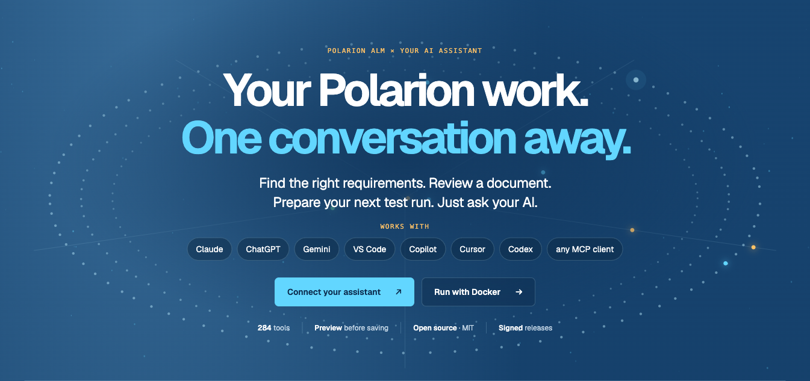
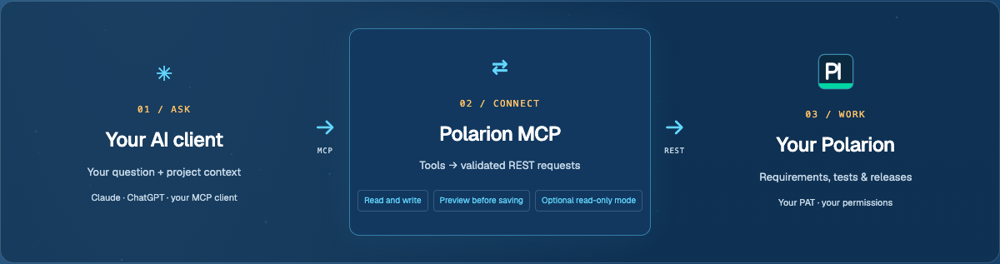
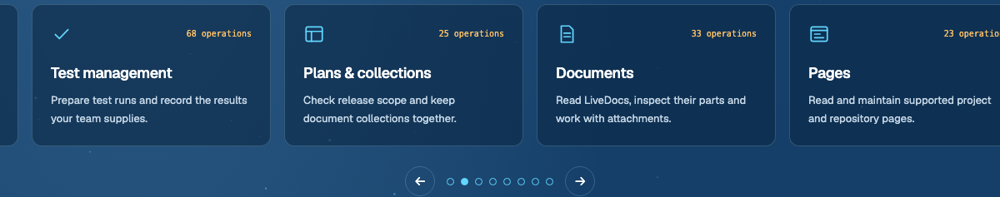
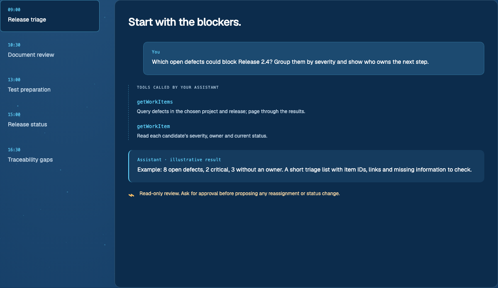

# Polarion MCP

**Your Polarion work, one conversation away.**

Find requirements, review documents and prepare test runs through your AI assistant.
An open-source [Model Context Protocol](https://modelcontextprotocol.io) server that exposes **every Polarion REST operation** (284 tools, generated from the current API definition).

[**Connect your assistant**](https://polarion-mcp.boesger.com/#clients) · [Daily workflows](https://polarion-mcp.boesger.com/#daily-use) · [Tool catalog](src/tools.ts)

On this page:

- [What the connector does for you](#what-the-connector-does-for-you)
- [A day with Polarion MCP](#a-day-with-polarion-mcp)
- [Get connected](#get-connected)
- [FAQ](#faq)
- [Feedback and community](#feedback-and-community)
- [Documentation](#documentation)
- [License](#license)

## What the connector does for you

**Your AI client → Polarion MCP → your Polarion REST API.** Ask a question; the assistant chooses tools, reads the returned data and proposes an answer or change.

- **Find answers:** search requirements and defects, read LiveDocs and inspect traceability links.
- **Prepare work:** draft test cases, prepare runs and record the test outcomes your team supplies.
- **Change data, safely:** the assistant can create and update Polarion data, and every write can be previewed first (`dry_run: true` shows the exact request without sending it). Prefer read access only? `MCP_READ_ONLY=1` blocks all writes. Set approval rules in your AI client; previews do not create an approval lock.
- **Inspect what you run:** MIT source, build provenance and signed container images. See [supply-chain verification](docs/quality/supply-chain.md).

| Domain | Outcome |
|---|---|
| Work items | Find requirements, triage defects, prepare field updates. |
| Documents and pages | Read LiveDocs, inspect parts, manage attachments and supported pages. |
| Test management | Prepare runs and record supplied results. |
| Plans and collections | Review release scope and document collections. |
| Projects, people and configuration | Discover accessible projects, users, allowed field values and metadata. |

The [landing page](https://polarion-mcp.boesger.com/#features) shows counts by domain, computed from `src/tools.ts`. The **284 tools** count covers generated REST operations; configured toolsets and additional helpers change the exposed catalog. Selected Work Item writes validate enumeration values, custom-field keys and user references. [Features and limits](docs/features.md) describe the scope.

## A day with Polarion MCP

These are illustrative conversations using real tools, not recorded outputs. Project types, link roles and permissions vary.

| Ask your assistant | Tools and result | Your control |
|---|---|---|
| “Which open defects could block this release?” | `getWorkItems`, `getWorkItem`: a scoped list of severity, owners and missing information. | Read-only triage; approve any later reassignment. |
| “Review this LiveDoc and propose clearer acceptance criteria for REQ-17.” | `getDocument`, `getDocumentParts`, `getWorkItem`, `patchWorkItem`: a rewrite of the requirement’s description. | Preview with `dry_run: true`; approve before saving. |
| “Draft tests from these requirements, then record the results I provide.” | `getWorkItems`, `postWorkItems`, `postTestRuns`, `postTestRecords`: proposed cases and a run, then supplied outcomes. | Check existing tests, preview each write and approve. The connector does not execute product tests. |
| “Summarize this release plan and its latest test runs.” | `getPlan`, `getWorkItems`, `getTestRuns`: a draft status update with source IDs and missing data. | You decide release readiness. |
| “Find requirements without a verifies link to a test case.” | `getWorkItems`, `getLinkedWorkItems`: a scoped gap list and existing candidate tests. | Confirm link roles and scope before creating anything. |

[Explore the chat-style walkthroughs](https://polarion-mcp.boesger.com/#daily-use).

## Get connected

Two setups, pick by where your client runs. You need a REST-enabled Polarion instance and a PAT. Every guide starts from nothing and ends with a check.

| Setup | Use it when | Guide |
|---|---|---|
| **Local (npm / npx)** | Your desktop or coding client runs on your computer and starts MCP servers. | [Local setup](docs/guides/local-npm.md) |
| **Server (Docker)** | Your client runs in the cloud (claude.ai, ChatGPT) or your team shares one server. | [Server setup](docs/guides/server-docker.md) |

Then open the guide for your client:

<!-- clients:start -->
| Client | Local | Server | Guide |
|---|---|---|---|
| Claude Desktop | Yes (docs) | Yes (docs) | [Open guide](https://github.com/phillipboesger/polarion-mcp/blob/main/docs/guides/clients/claude-desktop.md) |
| claude.ai | No | Yes (docs) | [Open guide](https://github.com/phillipboesger/polarion-mcp/blob/main/docs/guides/clients/claude-web-desktop.md) |
| Claude Code | Yes (docs) | Yes (docs) | [Open guide](https://github.com/phillipboesger/polarion-mcp/blob/main/docs/guides/clients/claude-code.md) |
| Claude API | No | Yes (docs) | [Open guide](https://github.com/phillipboesger/polarion-mcp/blob/main/docs/guides/clients/claude-api.md) |
| ChatGPT connector | No | Yes (docs) | [Open guide](https://github.com/phillipboesger/polarion-mcp/blob/main/docs/guides/clients/chatgpt-apps.md) |
| Custom GPT Actions | No | Yes (docs) | [Open guide](https://github.com/phillipboesger/polarion-mcp/blob/main/docs/guides/clients/custom-gpt.md) |
| OpenAI Responses API | No | Yes (docs) | [Open guide](https://github.com/phillipboesger/polarion-mcp/blob/main/docs/guides/clients/openai-api.md) |
| OpenAI Agents SDK | Yes (docs) | Yes (docs) | [Open guide](https://github.com/phillipboesger/polarion-mcp/blob/main/docs/guides/clients/openai-agents.md) |
| Codex | Yes (docs) | Yes (docs) | [Open guide](https://github.com/phillipboesger/polarion-mcp/blob/main/docs/guides/clients/codex-cli.md) |
| Microsoft Copilot Studio | No | Yes (docs) | [Open guide](https://github.com/phillipboesger/polarion-mcp/blob/main/docs/guides/clients/copilot-studio.md) |
| GitHub Copilot | Yes (docs) | Yes (docs) | [Open guide](https://github.com/phillipboesger/polarion-mcp/blob/main/docs/guides/clients/github-copilot.md) |
| Antigravity (CLI + IDE) | Yes (docs) | Yes (docs) | [Open guide](https://github.com/phillipboesger/polarion-mcp/blob/main/docs/guides/clients/antigravity.md) |
| Gemini (Enterprise) | No | Yes (docs) | [Open guide](https://github.com/phillipboesger/polarion-mcp/blob/main/docs/guides/clients/gemini-enterprise.md) |
| Cursor | Yes (docs) | Yes (docs) | [Open guide](https://github.com/phillipboesger/polarion-mcp/blob/main/docs/guides/clients/cursor.md) |
| Windsurf / Cascade | Yes (docs) | Yes (docs) | [Open guide](https://github.com/phillipboesger/polarion-mcp/blob/main/docs/guides/clients/windsurf.md) |
| JetBrains AI Assistant | Yes (docs) | No | [Open guide](https://github.com/phillipboesger/polarion-mcp/blob/main/docs/guides/clients/jetbrains-ai.md) |
| Docker team server | No | Yes (docs) | [Open guide](https://github.com/phillipboesger/polarion-mcp/blob/main/docs/guides/clients/docker.md) |
| Other AI provider / any MCP client | Yes (docs) | Yes (docs) | [Open guide](https://github.com/phillipboesger/polarion-mcp/blob/main/docs/guides/clients/generic-stdio.md) |
| Generic HTTP client | No | Yes (docs) | [Open guide](https://github.com/phillipboesger/polarion-mcp/blob/main/docs/guides/clients/generic-http.md) |
| REST wrapper / OpenAPI | No | Yes (docs) | [Open guide](https://github.com/phillipboesger/polarion-mcp/blob/main/docs/guides/clients/rest-wrapper.md) |
| n8n REST workflow | No | Yes (docs) | [Open guide](https://github.com/phillipboesger/polarion-mcp/blob/main/docs/guides/clients/n8n.md) |
| Microsoft 365 Copilot / Teams | No | Yes (docs) | [Open guide](https://github.com/phillipboesger/polarion-mcp/blob/main/docs/guides/clients/m365-copilot.md) |
| Mistral Le Chat | No | Yes (docs) | [Open guide](https://github.com/phillipboesger/polarion-mcp/blob/main/docs/guides/clients/mistral-le-chat.md) |
| Self-hosted models (Open WebUI) | No | Yes (docs) | [Open guide](https://github.com/phillipboesger/polarion-mcp/blob/main/docs/guides/clients/self-hosted.md) |
<!-- clients:end -->

For OpenAPI clients, Custom GPT Actions and n8n, run the separate REST wrapper (see the client guides). Keep credentials out of Git. There is no public Polarion relay. See also the [client index](docs/clients.md) and [deployment](docs/deployment.md).

## FAQ

<!-- faq:start -->

Which setup do I need?

Local: your client starts the server on your computer with `npx`. Server: you host the server with Docker and the client connects by URL; claude.ai and ChatGPT need it. Custom GPT Actions and n8n use the REST wrapper on a server.

How do I create a Polarion personal access token (PAT)?

Polarion user page > Personal Access Token > name and expiry > Create Token. Copy it at once, it is shown only once. If the page says token generation is not allowed, your administrator must enable `com.siemens.polarion.rest.security.restApiToken.enabled=true`.

Is my data safe? Which permissions apply?

Polarion enforces the permissions of the token owner. Server mode uses each caller's own token and the server stores none. Tool results go to your AI provider, so your organization's data policies apply.

Can I limit the server to read-only?

Yes: set `MCP_READ_ONLY=1` and restart. Only read tools are exposed. In write-enabled sessions every write tool can preview with `dry_run: true`.

My AI client says "Disconnected" or "Failed to connect".

Local: run `npx -y polarion-mcp` in a terminal with the same values to see the real error (Node older than 22 and JSON typos are common). Server: open `https://YOUR-SERVER/health`, then read `docker logs polarion-mcp`.

More answers: [docs/clients.md](docs/clients.md#more-questions).
<!-- faq:end -->

## Feedback and community

**Feedback and questions:** [open an issue](https://github.com/phillipboesger/polarion-mcp/issues). Include what you tried, your client and server mode, and what you expected. Leave credentials out.

Nothing documented for your case? Open an issue or PR on the repo and go wild. A clearer example, a small fix or a new integration can help the next team. Read [Contributing](.github/CONTRIBUTING.md) for source builds and checks. Report vulnerabilities through the [security policy](.github/SECURITY.md).

Built by [Phillip Bösger](https://github.com/phillipboesger), building on [@Jonasdero](https://github.com/Jonasdero).

## Documentation

[Docs index](docs/README.md) · [Configuration](docs/configuration.md) · [Deployment](docs/deployment.md) · [Security](docs/security.md) · [Usage](docs/usage.md) · [Architecture](docs/architecture.md) · [Extensions](docs/extensions.md) · [Releases](https://github.com/phillipboesger/polarion-mcp/releases)

## License

[MIT](LICENSE) © Phillip Bösger
